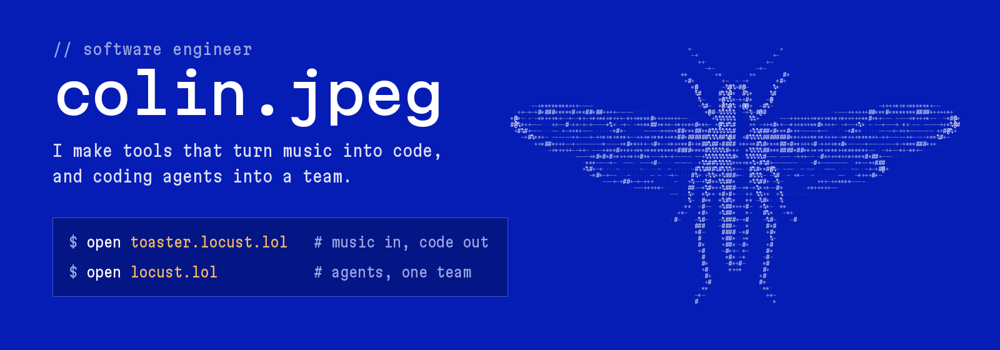
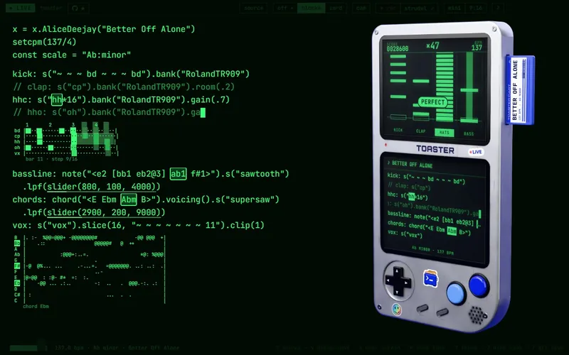
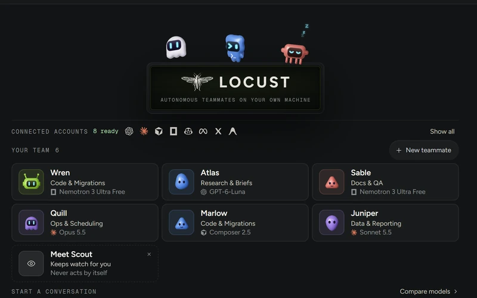

<table>
<tr>
<td width="50%" valign="top">

### [Toaster](https://github.com/StopBanning/toaster)

Hears whatever's playing and writes it out as live [Strudel](https://strudel.cc) code, with visuals that move to it.

**[Try it in your browser](https://toaster.locust.lol)** · [Download](https://github.com/StopBanning/toaster/releases/latest)

</td>
<td width="50%" valign="top">

### [Locust](https://github.com/StopBanning/locust)

Your AI coding agents as one team on your own computer: Claude Code, Codex, Cursor and more, on the models you pick.

**[Download](https://locust.lol)** · [Releases](https://github.com/StopBanning/locust/releases)

</td>
</tr>
</table>

Both free and open source. I build in public on [Threads](https://www.threads.com/@colin.jpeg) and [Instagram](https://www.instagram.com/colin.jpeg).
